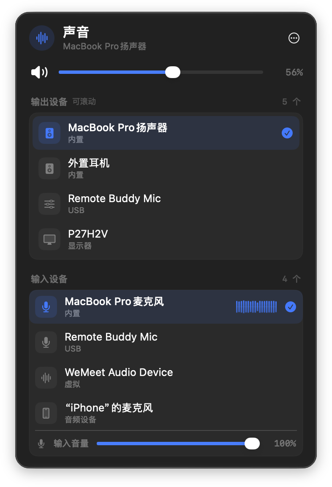

# SoundDeck

SoundDeck 是一个 macOS 菜单栏小工具，把平时要进「系统设置 → 声音」才能做的事情搬到菜单栏：调输出音量、静音、切扬声器、切麦克风、调输入音量，还有当前麦克风的实时波形。

它没有主窗口，也没有 Dock 图标。启动之后只在菜单栏出现一个小喇叭，点开就用。

> 当前版本：1.2  
> 系统要求：macOS 14 Sonoma 及以上  
> 架构：Apple Silicon / Intel 通用



## 它能做什么

- 直接拖动输出音量，滑块旁边显示百分比；点喇叭可以静音或取消静音。
- 列出当前可用的输出设备，点哪一行就切到哪个设备，当前设备会有蓝色勾选。
- 列出输入设备，点一下切换默认麦克风。
- 当前麦克风支持软件音量时，可以直接调输入音量。
- 当前选中的麦克风右侧会显示实时波形，只在面板打开时采集。
- 音量滑块使用 macOS 自带的反馈音，没有打包自己的音效。
- 监听 CoreAudio 的变化，用系统音量键、控制中心或其他 App 改过音量后，面板会自己更新。

## 下载安装

去 [Releases](https://github.com/melonal-a/SoundDeck/releases/latest) 页面下载最新的 `SoundDeck-1.2.dmg`，打开后把 **SoundDeck.app** 拖进「应用程序」。

如果这是第一次在这台 Mac 上运行，可能会遇到两种情况：

1. **macOS 提示无法验证开发者。** 这个 App 使用 ad-hoc 签名，没有做 Apple 公证。右键点 App，选「打开」，再确认一次即可。如果右键没有「打开」，可以去「系统设置 → 隐私与安全性」，在页面下方点「仍要打开」。
2. **macOS 询问麦克风权限。** 这是为了显示实时波形。允许之后就能看到波形；不允许也不影响音量和设备切换，面板里会给出提示。

详细步骤、界面说明和常见问题都写在 [使用教程](docs/USAGE.md) 里。

## 音量反馈音

拖动音量滑块时的那一下轻响，来自 macOS 自己的音量反馈文件，不是 SoundDeck 生成的音频。它也遵循系统设置里的「声音效果 → 改变音量时播放反馈」开关。把这个开关关掉，SoundDeck 也不会响。

输入音量滑块同样使用系统反馈音。如果你觉得输入音量不需要声音，可以关掉系统里的这个开关。

## 隐私

- 只有在菜单面板打开时才启动麦克风采集。
- 面板一关闭，音频引擎立即停止，输入 tap 被移除，不会在后台继续收麦克风声音。
- 音频数据只在内存里用来算波形高度，不会录音、不会写文件，也不会发到网络上。
- 拒绝麦克风权限后，声音和音频设备相关功能仍然可以正常使用。
- App 不联网，没有统计和埋点。

## 从源码构建

需要 macOS 14 或更高版本，以及 Xcode Command Line Tools。

```bash
xcode-select --install              # 如果还没装
git clone https://github.com/melonal-a/SoundDeck.git
cd SoundDeck
./Scripts/build.sh                  # 输出到 dist/SoundDeck.app
open dist/SoundDeck.app
```

只想构建当前架构可以这样：

```bash
ARCHS=arm64 ./Scripts/build.sh
```

重新打 DMG：

```bash
./Scripts/package.sh
```

构建脚本会用 ad-hoc 方式签名。要在别的 Mac 上正式分发，需要换成自己的 Developer ID 并做 notarization。

## 项目结构

```text
SoundDeck/
├── Sources/
│   ├── SoundDeckApp.swift           # 菜单栏应用入口，绑定面板生命周期和麦克风会话
│   ├── SoundPanelView.swift         # 面板界面
│   ├── AudioManager.swift           # CoreAudio 设备、默认设备、音量控制
│   ├── AudioDevice.swift            # 设备信息和图标
│   ├── MicrophoneMonitor.swift      # 只在面板打开时工作的麦克风采集
│   ├── MicrophoneWaveformView.swift # 实时波形绘制
│   └── SystemVolumeFeedback.swift   # 播放 macOS 自带的音量反馈音
├── Resources/
│   ├── Info.plist
│   └── AppIcon.icns
├── Scripts/
│   ├── build.sh
│   ├── package.sh
│   ├── make-icon.sh
│   └── make-icon.swift
├── docs/
│   ├── USAGE.md
│   └── screenshot.png
├── CHANGELOG.md
└── README.md
```

## 已知限制

- 音量滑块能不能用，取决于设备是否提供系统级软件音量。部分 HDMI 显示器、虚拟声卡或音频接口只支持硬件音量，这时滑块会变灰，但设备切换照常。
- 不能给每个 App 单独调音量。
- 这是菜单栏工具，不替代系统自带的音量键，也不会拦截音量键。
- 没有自动启动开关，需要的话在「系统设置 → 通用 → 登录项」里手动添加。

## 更新记录

见 [CHANGELOG.md](CHANGELOG.md)。

## 许可证

代码使用 MIT 协议，详见 [LICENSE](LICENSE)。

## 问题反馈

遇到问题可以在 [Issues](https://github.com/melonal-a/SoundDeck/issues) 里提，尽量带上 macOS 版本、出问题的设备和复现步骤。日志也可以帮忙定位：

```bash
log show --last 5m --info --debug --predicate 'subsystem == "local.sounddeck.app"'
```
