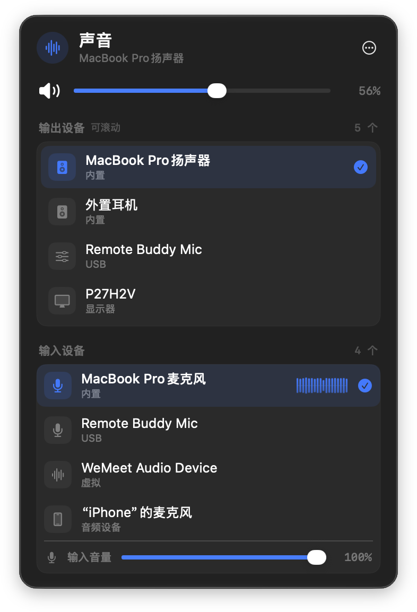

# SoundDeck 使用教程

SoundDeck 装好以后不会弹主窗口，也不会出现在 Dock 里。它只做一件事：在菜单栏放一个小喇叭，点开就是声音控制面板。

这篇教程从下载安装开始，把界面上的每一块、麦克风权限、系统反馈音和常见问题都过一遍。第一次用的话，看完前四节基本就够了；遇到问题再跳到后面的「常见问题」。



## 目录

- [1. 下载和安装](#1-下载和安装)
- [2. 第一次打开](#2-第一次打开)
- [3. 面板各部分说明](#3-面板各部分说明)
- [4. 几个日常场景](#4-几个日常场景)
- [5. 音量反馈音](#5-音量反馈音)
- [6. 麦克风权限与隐私](#6-麦克风权限与隐私)
- [7. 常见问题](#7-常见问题)
- [8. 从源码构建](#8-从源码构建)
- [9. 更新与卸载](#9-更新与卸载)

## 1. 下载和安装

### 1.1 下载

打开 [Releases](https://github.com/melonal-a/SoundDeck/releases/latest) 页面，下载最新的 `SoundDeck-1.2.dmg`。

不要下载 GitHub 自动生成的 `Source code` 压缩包，那个是源码，不是能直接双击运行的 App。

如果 Releases 页面打不开，也可以直接从[这里下载 1.2 的安装包](https://github.com/melonal-a/SoundDeck/releases/download/v1.2/SoundDeck-1.2.dmg)。

### 1.2 拖进应用程序

双击下载好的 DMG，会打开一个 Finder 窗口。把里面的 `SoundDeck.app` 拖到「应用程序」文件夹，然后推出 DMG。

建议从「应用程序」里运行，不要直接在 DMG 里双击。前者在后续更新和权限记录上更稳定。

### 1.3 第一次打开被 macOS 拦截

这个 App 没有上架 App Store，也没有做 Apple 公证，使用的是 ad-hoc 签名。第一次从网上下载运行时，macOS 可能会提示「无法验证开发者」或者「Apple 无法检查 App 是否包含恶意软件」。

可以这样处理：

1. 在 Finder 里找到 `SoundDeck.app`。
2. 按住 Control 键点它，选「打开」。
3. 系统还会再问一次，点「打开」。

如果右键菜单里没有「打开」，去「系统设置 → 隐私与安全性」，往下找到刚被拦截的 SoundDeck，点「仍要打开」。这一步可能需要输入登录密码。

只有你确认安装包来自这个仓库时才继续。这个 App 是开源的，源码就在仓库里，介意安全的话可以自己编译。

### 1.4 菜单栏图标在哪

启动 SoundDeck 后，菜单栏右侧会多出一个扬声器图标。它和系统自带的音量图标长得有点像，注意区分。

如果菜单栏图标太多、被挤到屏幕外或者被刘海挡住，可以：

- 退出几个暂时不用的菜单栏程序，给新图标腾位置；
- 按住 Command 键，用鼠标拖动菜单栏图标，把它挪到可见的位置；
- 打开「活动监视器」，搜索 SoundDeck，确认进程有没有在运行。

这个 App 没有 Dock 图标，按 Command+Tab 也切不到它，只能从菜单栏找到。

## 2. 第一次打开

点一下菜单栏的扬声器图标，会弹出控制面板。

第一次打开时，系统会询问是否允许 SoundDeck 使用麦克风。这个权限只用于面板打开时的实时波形，不会录音，也不会在后台采集。

- 想用波形：点「允许」。
- 不用波形：点「不允许」也完全可以，音量调节、静音和输出/输入设备切换都不受影响，只是选中的麦克风行不会显示波形。

有时系统的权限窗口弹出后，刚才打开的菜单面板会自己关掉。这不是 App 崩溃了，重新点一下菜单栏图标就行。

如果之前误点了「不允许」，后面想重新打开波形：

1. 打开「系统设置 → 隐私与安全性 → 麦克风」。
2. 找到 SoundDeck，把开关打开。
3. 把 SoundDeck 的面板关掉再打开一次，让它重新检查权限。

在面板底部出现「允许麦克风访问后显示实时波形」提示时，也可以直接点旁边的「打开设置」。

## 3. 面板各部分说明

面板从上到下分成几块，逻辑和系统「声音」设置差不多，只是把常用操作放在了一起。

### 3.1 输出音量

最上面是输出音量。

- 左边的喇叭按钮：点一下静音，再点一下恢复。按钮图标会随音量大小和静音状态变化。
- 中间滑块：拖动改变当前默认输出设备的音量，右侧显示百分比。
- 当静音状态下拖动滑块时，会先取消静音再调整音量，和常见的音量控件一样。

有些输出设备没有系统级软件音量，比如部分 HDMI 显示器、虚拟声卡或音频接口。这种情况下滑块会是灰色的，百分比显示为「—」。不是 App 坏了，是设备本身没有提供这个控制项。设备切换仍然可以正常使用，音量需要在显示器或音频设备自己的旋钮、驱动面板里调整。

### 3.2 输出设备

这一块列出当前 Mac 能用的所有输出设备。

每一行左边是设备类型图标，右边会显示「内置」「USB」「蓝牙」「显示器」「虚拟」之类的来源。当前默认输出设备会带一个蓝色勾选，整行也是淡蓝色背景。

点任意一行，就会把 macOS 的默认输出设备切过去。SoundDeck 会同时把系统提示音的输出也切过去，和系统「声音」设置里的行为一致。

设备超过四台时，列表可以滚动，标题旁边会出现「可滚动」的提示。切换过设备后，列表会自动把当前设备滚到可见位置。

### 3.3 输入设备

输入设备就是麦克风、USB 麦克风、音频接口输入、连续互通设备等。

点一行就会切换 macOS 的默认输入设备，蓝色勾选会移动到新的设备上。当前选中的麦克风会显示实时波形。

有些设备名字后面的来源会显示「连续互通」，比如 iPhone 的麦克风。它们也能被选中，但是不一定支持输入音量控制。

### 3.4 输入音量

输入设备列表下面是「输入音量」。

- 滑块调整的是当前默认输入设备的音量。
- 百分比在这个设备的软件音量可用时才会显示数字。
- 如果当前设备不支持系统输入音量，滑块会变灰，右侧显示「—」。这时可以试试音频设备自带的面板，或者在「音频 MIDI 设置」里调整。

输入音量和输出音量是两回事。输入音量影响的是麦克风录进去的电平，不会改变你听歌或看视频的声音大小。

### 3.5 实时麦克风波形

当前选中的输入设备行右侧会有一小段波形。它只在面板打开时工作：

- 面板打开时，SoundDeck 启动麦克风采集并画波形。
- 关闭面板、点一下其他 App、或者按 Esc 让面板消失后，采集会立即停止。
- 重新打开面板才会重新开始采集。
- 安静的时候波形是一条细线，说话或者附近有声音时会动起来。
- 输出设备行没有波形，这是故意做的，只有输入设备有。

如果你切到别的麦克风，波形会跟着切到新设备，短暂空白一下再恢复。

### 3.6 右上角的「…」

面板右上角有三个点，点开是一个小菜单：

- **打开系统声音设置**：直接跳到 macOS 的「声音」设置。
- **重新扫描音频设备**：手动刷新一次设备列表。一般插拔设备会自动刷新，这里只是兜底。
- **关于 SoundDeck 1.2**：查看版本和 App 信息。
- **退出 SoundDeck**：完全退出 App，菜单栏图标也会消失。

## 4. 几个日常场景

### 插上耳机后想让声音从耳机出来

点开面板，在「输出设备」里点一下耳机那一行。等蓝色勾选挪过去就好，不需要重启播放器。大多数 App 会立刻跟着系统默认输出切换；个别 App 自己固定了输出设备，可能要在那个 App 的设置里改。

### 开会时换成 USB 麦克风

在「输入设备」里点 USB 麦克风，选中后看看下方的输入音量滑块是否可用。如果要用实时波形确认麦克风有没有收到声音，面板开着的时候对着麦克风说两句话，波形会跟着动。

会议软件如果已经在运行，有的会自动跟随系统默认输入，有的需要在会议软件里再选一次。SoundDeck 改的是 macOS 的默认输入设备，不会替每个 App 单独改设置。

### 临时静音

点一下最左边的喇叭图标就会静音，再点一下恢复。静音不会改变你原来的音量百分比。

### 让 SoundDeck 开机自动启动

打开「系统设置 → 通用 → 登录项」，在「登录时打开」里点「+」，选择「应用程序」里的 SoundDeck。因为这个 App 没有 Dock 图标，添加后它会在登录后安静地出现在菜单栏。

### 退出 App

点面板右上角的「…」，选「退出 SoundDeck」。如果只是关掉面板，App 还在后台待命，但麦克风采集已经停止，不会继续占用麦克风。

## 5. 音量反馈音

拖动输出或输入音量滑块时，会听到一下很短的「哒」的声音。这是 macOS 系统自带的音量反馈音，不是 SoundDeck 自己生成的音频。

SoundDeck 直接读取系统文件：

```text
/System/Library/LoginPlugins/BezelServices.loginPlugin/Contents/Resources/volume.aiff
```

并且遵循系统设置里的开关：

```text
系统设置 → 声音 → 声音效果 → 改变音量时播放反馈
```

如果把系统里的这个开关关掉，SoundDeck 也不会播放反馈音。把系统输出静音或者音量调到很低时，反馈音自然也会很小或者听不到。

输入音量滑块也使用同一个系统反馈音。如果你只希望在调输出音量时听到反馈，关掉系统这个开关就行，两个滑块都会一起安静。

## 6. 麦克风权限与隐私

这是整个 App 里最需要注意的一部分，也是 SoundDeck 和普通音量工具不一样的地方。

### 只在面板打开时采集

麦克风采集和面板的显示状态绑定在一起：

- 点开菜单栏图标：面板出现，开始采集。
- 面板消失：停止音频引擎、移除输入 tap、清空波形数据。

点击面板外、切换到别的 App、按 Esc、点菜单里的「打开系统设置」等操作，都会让这个临时面板关闭，采集也就跟着停止。

SoundDeck 不会在后台持续监听麦克风，也不会把音频写到磁盘。波形是用一小段内存里的样本算出柱状高度，原始样本处理完就丢掉了。

### 不录音，不联网

App 不包含录音功能，也不会上传音频或设备信息。整个项目没有网络请求代码。音频数据只在 `MicrophoneMonitor` 里用来生成 18 根波形柱的高度。

### 权限被拒绝怎么办

如果权限被拒绝，输入设备行会显示一个带斜杠的麦克风图标，面板底部会出现「允许麦克风访问后显示实时波形」的提示。

按提示点「打开设置」，在「系统设置 → 隐私与安全性 → 麦克风」里把 SoundDeck 打开，然后关掉面板再打开一次。

### 更新后再次询问权限

因为项目使用 ad-hoc 签名，macOS 可能在每次安装新构建时把它当成一个新的 App，于是再次询问麦克风权限。点「允许」即可。如果你是用 Xcode 或脚本自己构建的，也会遇到同样的情况。

## 7. 常见问题

### 菜单栏找不到图标

先确认 SoundDeck 在运行。打开「活动监视器」，搜索 SoundDeck，看有没有进程。如果没有，重新打开 App。

如果进程在，但图标看不到，通常是菜单栏太挤，或者图标被刘海挡住了。退出几个不用的菜单栏 App，或者按住 Command 拖动图标，把它挪到可见区域。

### App 打不开，提示无法验证开发者

这是没有做 Apple 公证导致的。右键 App →「打开」，或者去「系统设置 → 隐私与安全性」点「仍要打开」。不要直接从终端用 `sudo` 运行 App，没有这个必要。

### 输出音量滑块是灰色的

当前输出设备不提供系统级软件音量控制。常见于 HDMI/DisplayPort 显示器、部分虚拟声卡和音频接口。设备切换本身仍然可用，音量请在这些设备自己的控制面板里改。

### 输入音量滑块是灰色的

同上，当前麦克风不支持系统输入音量。内置麦克风和不少 USB 麦克风是支持的，iPhone 连续互通麦克风通常不支持，但这不影响波形显示。

### 波形不动，或者是一条直线

先确认几件事：

- 面板确实是打开状态，没有被其他窗口挡掉。
- 当前选中的输入设备是对的，并且那个设备真的在收音。
- 系统「麦克风」权限已经给了 SoundDeck。
- 输入设备本身有信号，比如在会议软件或「语音备忘录」里能看到电平。

安静环境下波形本来就是一条贴近中间的细线。说句话或者放点声音，它会明显动起来。如果还是不动，关掉面板再打开一次；还不行的话，去 GitHub Issues 提一下，附上 macOS 版本和使用的设备。

### 没有音量反馈音

先看系统输出是不是静音，音量是不是特别低。然后检查「系统设置 → 声音 → 声音效果」里的「改变音量时播放反馈」有没有打开。SoundDeck 不会绕过这个系统开关。

另外，反馈音只在拖动 SoundDeck 里的音量滑块时播放。用系统音量键调音量时，声音由 macOS 自己处理。

### 切换了输出设备，但某个 App 的声音没变

SoundDeck 改的是 macOS 默认输出。有些播放器或会议软件会自己记住并锁定一个输出设备，这种要去那个 App 自己的音频设置里改。系统级声音和大多数普通播放器会跟随默认设备。

### 面板一打开就没了

菜单栏面板是临时的，点击面板外面的区域会自动关闭。如果打开后马上被其他窗口抢走焦点，会看起来像是闪一下就消失。重新点图标即可。

另外，第一次授权的系统弹窗也可能让面板自动关掉，授权完再点一次图标就好。

### 怎么确认版本

点开面板右上角的「…」，菜单里会显示「关于 SoundDeck 1.2」。也可以在终端里看：

```bash
/usr/libexec/PlistBuddy -c 'Print :CFBundleShortVersionString' /Applications/SoundDeck.app/Contents/Info.plist
```

### 为什么没有扬声器波形

这是按需求故意没做的。当前只给输入设备，也就是麦克风行加了波形。

## 8. 从源码构建

需要 macOS 14 或以上，以及 Xcode Command Line Tools：

```bash
xcode-select --install
```

然后：

```bash
git clone https://github.com/melonal-a/SoundDeck.git
cd SoundDeck
./Scripts/build.sh
open dist/SoundDeck.app
```

默认会编译 Apple Silicon 和 Intel 两种架构。只想当前架构能快一点：

```bash
ARCHS=arm64 ./Scripts/build.sh
```

重新生成 App 图标：

```bash
./Scripts/make-icon.sh
```

重新打包 DMG：

```bash
./Scripts/package.sh
```

构建脚本最后会用 ad-hoc 方式签名，所以可以在本机直接运行。要分发给其他人、并且不想让对方每次更新都重新授权麦克风，需要换用自己的 Developer ID 做签名，再提交 Apple 公证。这部分不在本仓库的脚本里。

## 9. 更新与卸载

### 更新

去 Releases 下载新的 DMG，退出旧版 SoundDeck，把新 App 拖进「应用程序」覆盖旧版即可。因为签名方式的关系，更新后系统可能会重新询问一次麦克风权限。

### 卸载

1. 在面板右上角的「…」里退出 SoundDeck。
2. 把「应用程序」里的 SoundDeck.app 拖进废纸篓。
3. 如果之前设置过开机启动，去「系统设置 → 通用 → 登录项」里把 SoundDeck 删掉。
4. 麦克风权限记录可以在「系统设置 → 隐私与安全性 → 麦克风」里手动移除。

App 没有额外的后台守护进程，也没有把配置文件写到很多地方，删掉 App 基本就干净了。

## 反馈

如果碰到教程里没写的情况，可以在 [Issues](https://github.com/melonal-a/SoundDeck/issues) 里提。附上这些信息会更容易定位：

- macOS 版本（比如 macOS 26.1）
- Mac 型号
- 出问题的音频设备名称和类型
- 复现步骤
- 可能的话，贴一下日志：

```bash
log show --last 5m --info --debug --predicate 'subsystem == "local.sounddeck.app"'
```
